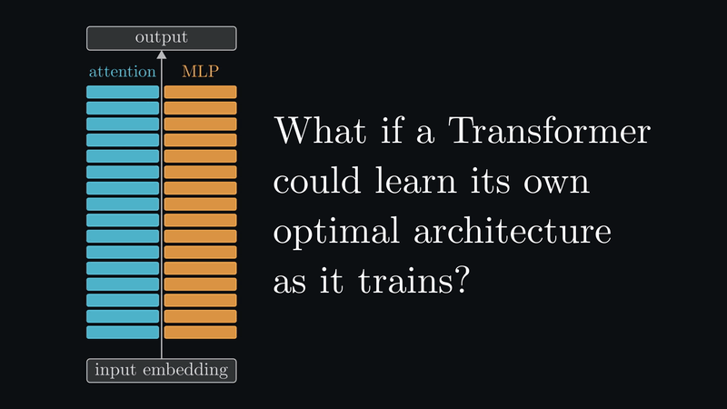

# Model Carving

Code for **[Model Carving: Training Transformers That Optimize Their Own Topology](https://arxiv.org/abs/2611.27962)**
(Kaden Zheng, Pratyusha Sharma). See also the [blog post](https://kadenzheng.com/model-carving/)!



Model Carving is a method for learning both a Transformer's weights and its architecture in one run! Simply by leveraging gates, we can scale each sublayer and connection write to the residual stream. Applying a slight sparsity pressure incentivizes gates to close, and we construct this pressure as the loss its compute would buy as extra training tokens. A gate that falls to zero removes its sublayer from the graph mid-training, learning a smaller, faster, and better Transformer from within!

## Setup

Tested with Python 3.11:

```sh
pip install "jax[cuda12]==0.9.0.1" flax==0.12.2 optax==0.2.7 numpy pyyaml
```

## Data

`train.data` in each config names a folder of tokenized text:

| File               | Contents                                                                                |
| ------------------ | --------------------------------------------------------------------------------------- |
| `train.bin`        | Training tokens as one flat `uint32` array, read in order                               |
| `val.bin`          | Val tokens in the same format, and the first `train.val_sequences` sequences are scored |
| `byte_lengths.npy` | UTF-8 byte length of each token id, for bits per byte                                   |

## Training

```sh
python train.py configs/standard_140m.yaml             # for the dense (full-depth) baseline
python train.py configs/standard_140m.yaml --carving   # for Model Carving
```

For several GPUs, start one process per GPU under SLURM, e.g.  
`srun -N 2 --ntasks-per-node=4 --gres=gpu:4 python train.py ...`. Each batch is split across all GPUs.

Each run writes `metrics.jsonl`, `final_params.pkl` and, for Carving, `carved.json` (the kept sublayers and their gates).
`--save-every N` writes `checkpoint.pkl` every N updates, and `--resume PATH` continues from it.

## Code

```
train.py          entry point
configs/          standard Transformers from 140M to 2.7B, looped from 140M to 1.3B
carving/
  carver.py       pressure, gate step, removal, cooldown
  gates.py        gate update (Eq. 8)
  rate.py         rate of learning: snapshot readings, power-law fit
  budget.py       FLOP costs, budget, projected end of run
  residual.py     gated write and learned connections
  model/          standard and looped Transformers
  training/       data, optimizers, training step and loop, checkpoints
```

## Citation

```bibtex
@misc{zheng2026carving,
  title         = {Model Carving: Training Transformers That Optimize Their Own Topology},
  author        = {Kaden Zheng and Pratyusha Sharma},
  year          = {2026},
  eprint        = {2611.27962},
  archivePrefix = {arXiv},
  primaryClass  = {cs.LG},
  url           = {https://arxiv.org/abs/2611.27962}
}
```

## License

MIT (see `LICENSE`). Parts of the model and trainer derive from [theseus](https://theseus.jemoka.com/)
by Houjun Liu, also MIT.
